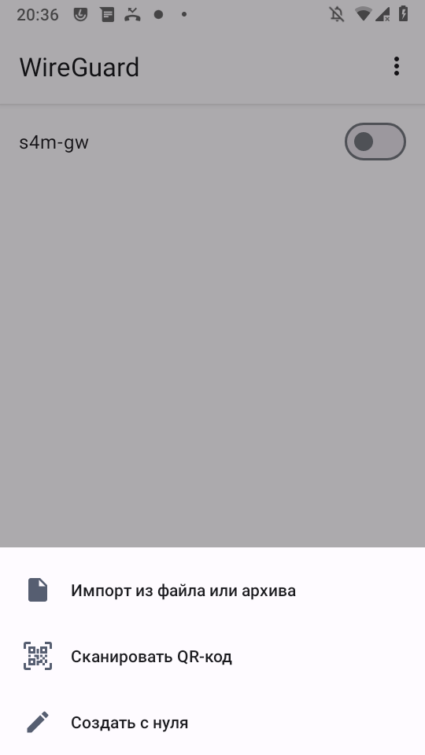
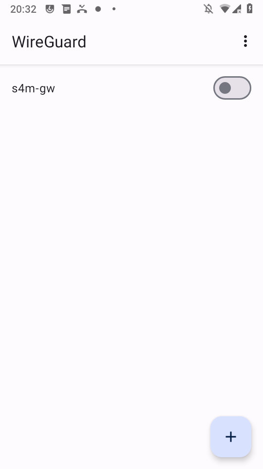
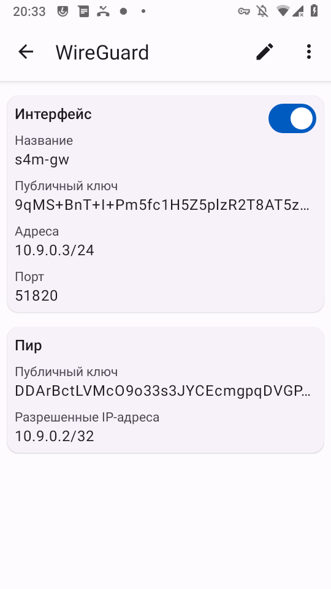

# WireGuard: шлюз сам себе VPN-сервер

> ℹ VPN - это **запасной** путь выхода в интернет. Основной выбор владельца - прямой доступ
> (белый IP + проброс портов), см. [`internet-security.md`](internet-security.md). VPN нужен,
> если белого IP нет (CGNAT) или не хочешь светить SIP наружу.

Чтобы звонки и SMS доходили **из любой точки**, а не только внутри домашней Wi-Fi, софтфон и
шлюз надо объединить в одну overlay-сеть. Самый самодостаточный вариант - **поднять
VPN-сервер прямо на телефоне-шлюзе**: отдельный VPS/роутер не нужен, наружу торчит только тихий
UDP-порт WireGuard (а не SIP - это снимает весь toll-fraud риск, см.
[`internet-security.md`](internet-security.md)).

> ⚠ **Статус проверки 22.10.2026 (частично).** VPN-транспорт поднимается и работает: регистратор
> gsm2sip **принимает REGISTER через overlay** (`Registrar: 100 -> 10.9.0.2 exp=900`). НО
> сквозная регистрация **пока не доходит до зелёной** из-за бага обратного пути (см. ниже).
> На Track A (voicesipagent) та же схема прошла зелёной — там ответ уходит правильно.

## ⛔ Известный баг: ответ уходит мимо туннеля

При регистрации через overlay gsm2sip отвечает `200 OK` **с адреса Wi-Fi** (`192.168.x.x:5062`)
и пакет уходит **в Wi-Fi-интерфейс, а не в туннель `tun0`**. До overlay-клиента `10.9.0.2`
ответ не доходит → клиент бесконечно шлёт повторы → регистрация красная. Подтверждено tcpdump:
на `tun0` видны только входящие REGISTER, ответ `200 OK` идёт через wlan0.

**Что чинить (TODO в коде):** не привязывать ответный сокет к адресу wlan0 — отвечать через тот
же сокет/интерфейс, на который пришёл REGISTER (как это делает voicesipagent). До фикса рабочий
путь «софтфон → gsm2sip через WireGuard» не замкнётся; VPN-транспорт при этом исправен и годится,
как только баг устранят.

## Что нужно и чего не хватит

Приложение WireGuard слушает свой порт через системный `VpnService` — телефон-шлюз **может быть
сервером сам по себе**. Но VPN-сервер на телефоне ещё не делает его видимым из интернета:

- **Белый (без CGNAT) IP дома** — достаточно пробросить на роутере **один UDP-порт 51820** на
  телефон-шлюз. Наружу видно только WireGuard.
- **Серый IP (CGNAT) с обеих сторон** — прямого проброса нет. Нужна одна точка с предсказуемым
  адресом — **координатор NAT-traversal** (сам трафик не гоняет, только сводит стороны и помогает
  пробить NAT; не вышло напрямую — через relay): **Tailscale/Headscale, Netbird, ZeroTier,
  Nebula**. «Статичный IP» нужен только координатору — дешёвый VPS или бесплатный Tailscale.

## Overlay-адресация (пример)

| Узел | overlay-IP | Роль | Порт |
|---|---|---|---|
| Телефон-шлюз (эта SIM) | `10.9.0.3/24` | сервер | 51820 |
| Дальний телефон (софтфон) | `10.9.0.2/24` | клиент | — |

## Шаг 1. Поставить WireGuard

На оба телефона — [WireGuard](https://f-droid.org/packages/com.wireguard.android/)
(`com.wireguard.android`).

## Шаг 2. Ключи и два конфига

**Шлюз (сервер), `gw.conf`:**

```ini
[Interface]
PrivateKey = <приватный ключ шлюза>
Address    = 10.9.0.3/24
ListenPort = 51820

[Peer]
PublicKey  = <публичный ключ софтфона>
AllowedIPs = 10.9.0.2/32
```

**Софтфон (клиент), `client.conf`:**

```ini
[Interface]
PrivateKey = <приватный ключ софтфона>
Address    = 10.9.0.2/24

[Peer]
PublicKey           = <публичный ключ шлюза>
Endpoint            = <белый IP или домен дома>:51820
AllowedIPs          = 10.9.0.3/32
PersistentKeepalive = 25
```

> ✅ **Рекомендуется раздельный туннель (split-tunnel): `AllowedIPs = 10.9.0.3/32`** - только
> overlay-адрес шлюза, а не `0.0.0.0/0`. Тогда через VPN идут **только** звонки и SMS (трафик к
> шлюзу), а весь остальной интернет телефона - напрямую. Это важно, если шлюз в другой стране:
> полный туннель (`0.0.0.0/0`) увёл бы весь трафик телефона через страну шлюза.
>
> Почему это должно работать: маршрут к `10.9.0.3` уходит в `tun0`, пакет берёт источником
> overlay-адрес `10.9.0.2`, и шлюз видит REGISTER с туннеля. (Если шлюзов два, укажи всю
> overlay-подсеть - `10.9.0.0/24`.)
>
> ⚠ **Честно:** split-tunnel-на-overlay-IP выведен по логике маршрутизации и **на устройствах в
> поле пока не проверялся** (к тому же на треке B мешает баг обратного пути ниже). Прежний
> зелёный транспортный тест на треке A (22.10.2026) шёл на стенде с **полным** туннелем
> (`0.0.0.0/0`) в одной Wi-Fi - считай это стендовой мерой, а не рекомендацией.
>
> `PersistentKeepalive = 25` держит NAT-привязку.

## Шаг 3. Импорт конфига

**Вариант А (через приложение, как на Track A):** WireGuard → **«+»** → **«Импорт из файла или
архива»** → выбрать `.conf`.



**Вариант Б (рут, быстрее — без файлового пикера):** положить `.conf` прямо в каталог приложения
и починить владельца/контекст:

```sh
su
cp gw.conf /data/data/com.wireguard.android/files/gw.conf
chown u0_a82:u0_a82 /data/data/com.wireguard.android/files/gw.conf   # uid приложения свой
restorecon /data/data/com.wireguard.android/files/gw.conf
```

Туннель после импорта виден в списке (пока выключен); открыв его, видно состав — интерфейс
шлюза с overlay-адресом, портом и пиром:




## Шаг 4. Включить туннель

Тумблером. Активный — тумблер синий, в статусбаре значок VPN-ключа. Включить на обоих телефонах.



## Шаг 5. Нацелить софтфон на overlay-адрес шлюза

В baresip аккаунт на этот шлюз: `sip:100@10.9.0.3:5062`, включить «Регистрация»
(см. [`client-baresip.md`](client-baresip.md)).

## Два шлюза (две SIM)

Надёжный путь — **каждый шлюз свой сервер** (A = `10.9.0.1`, B = `10.9.0.3`), софтфон держит два
туннеля и две регистрации. «Один хаб на всех» требует IP-форвардинга на хабе (рут: `ip_forward`
+ MASQUERADE); на нерутованном телефоне-хабе второй шлюз-клиент недоступен.

## Диагностика

- Хэндшейк WireGuard не проходит → `Endpoint`/проброс порта, либо телефон спит.
- Регистратор в журнале принимает (`Registrar: 100 -> 10.9.0.2`), а клиент красный → это
  **баг обратного пути** выше: `200 OK` уходит через wlan0, не через туннель. До фикса не лечится
  настройкой.
