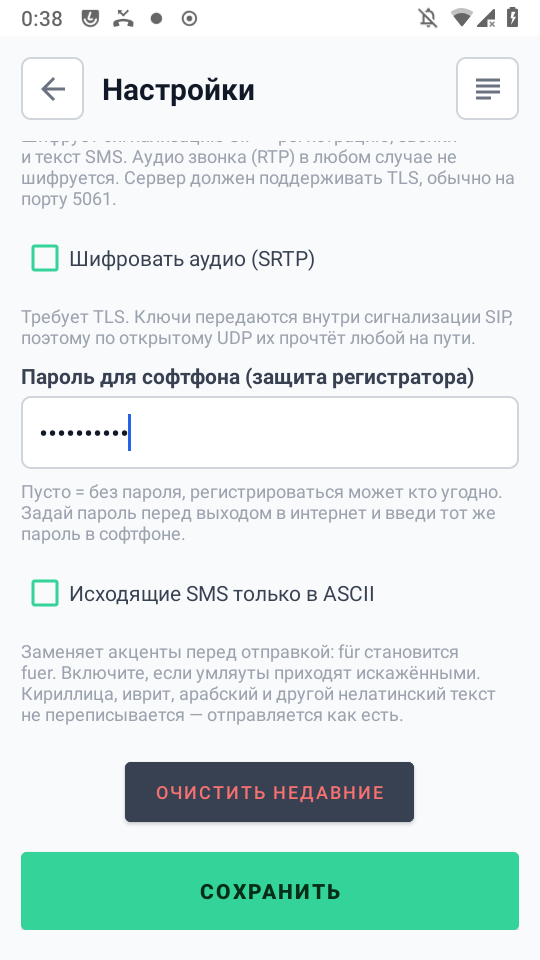

# Как всё настроить с нуля (для новичка)

Простым языком, по шагам. Если что-то не так - смотри «Частые проблемы» в конце.

> ⚠ **Честно сразу:** этот трек (B) - для **старых Qualcomm-трубок с рутом** (LineageOS + Magisk).
> Он требует прошивки аппарата (TWRP/Odin) - это не «для совсем чайников». Если тебе нужен путь
> **без рута и без прошивки** на современном телефоне - смотри трек A (форк avsa). Здесь же
> предполагается, что ты готов прошить старый аппарат вроде Samsung S4 mini.

## Что это и что получится

Старый телефон (напр. Samsung S4 mini) с твоей домашней SIM лежит дома на зарядке и ловит
**звонки и SMS** на домашний номер, отдавая их через интернет на твой обычный телефон в любой
точке - **без роуминга и без чужих серверов**.

**Что нужно:**
- **Телефон-шлюз** - старый Qualcomm-аппарат (список ниже), прошитый LineageOS + Magisk.
- **Твой телефон** - любой, с интернетом. На него поставим софтфон.
- **ПК** - для прошивки и установки.

## Какой аппарат подойдёт

- **Только Qualcomm**, НЕ Exynos (на Exynos нужного аудио-тракта нет).
- Нужен **LineageOS + Magisk** (на стоковой прошивке звук вызова обычно не выводится).
- Проверенные: Xiaomi Poco X3 NFC (`surya`), Samsung S4 mini **GT-I9190** (`serrano3g`) и
  **GT-I9195** (`serranolte`).

---

## Часть 1. Готовим телефон-шлюз

### 1.1. Прошить аппарат (если ещё не прошит)
Нужно: LineageOS 16 + Magisk. Кратко (подробно и файлы - в README, раздел «Прошивка чистого
аппарата»):
1. TWRP-рекавери через Odin (слот AP).
2. В TWRP: Wipe → установить LineageOS 16 → перезагрузиться, первично настроить (GApps не нужны).
3. Поставить **Magisk** (`Magisk-v30.7.apk`), дать root.

Если аппарат уже на LineageOS + Magisk - переходи к 1.2.

### 1.2. Поставить серверную часть (Magisk-модуль)
1. На ПК собери модуль: в корне репозитория `./build.sh release` (нужны JDK 17 + Android SDK) →
   получится **`gateway-magisk.zip`** (это APK + права + звук, всё вместе). Грабли сборки -
   [`build.md`](build.md).
2. Скопируй `gateway-magisk.zip` на телефон → открой **Magisk → Модули → Установить из файла** →
   выбери zip → **перезагрузка**. Модуль сам поставит приложение, выдаст права и снимет
   аудио-ограничения.
3. **Сделай gsm2sip звонилкой по умолчанию:** Настройки → Приложения → По умолчанию → Телефон →
   **gsm2sip**. Без этого приложение не будет само отвечать на звонки.
4. Открой приложение - дальше настройки.

### 1.3. Настроить приложение
Шестерёнка справа вверху. Для режима «устройство в себе»:
- **Встроенный регистратор** - **включён** (по умолчанию). SIP-сервер/логин/пароль не нужны.
- **Own Number** - любое (мы ставили `100`); в режиме сервера на выбор софтфона не влияет.
- **STUN** - для домашнего теста **выключен**; для выхода в интернет по белому IP - включить.
- Порт шлюза - **5062** (зашит).

Узнай IP телефона-шлюза (запиши): Настройки LineageOS → О телефоне → Статус, или по adb
`adb shell "ip -4 addr show wlan0 | grep -o 'inet [0-9.]*'"`.

---

## Часть 2. Твой телефон (софтфон)

1. Поставь **baresip** (F-Droid: `com.tutpro.baresip`). Именно его - Linphone **не шлёт SMS**.
2. **⋮ → «Профили»** → впиши (подставь IP шлюза):
   ```
   sip:100@<IP-шлюза>:5062
   ```
   → **«+»** → включи **«Регистрация»**. Пароль/прокси не нужны.
   > ⚠ **Порт `:5062` обязателен** прямо в адресе.
3. Аккаунт загорелся **зелёным** - готово (в пределах дома).

---

## Часть 3. Проверка дома (оба в одной Wi-Fi)

- Позвони на домашнюю SIM с другого телефона - в baresip придёт входящий.
- Пошли SMS - придёт в baresip; ответь - уйдёт по SIM шлюза.

Ходят звонки и SMS - **ядро работает**.

---

## Часть 4. Чтобы работало из любой точки (интернет)

### Прямой доступ (белый IP + проброс портов)
Если дома **белый (публичный) IP** без CGNAT:
1. Закрепи IP шлюза на роутере (DHCP-резервация по MAC).
2. Пробрось **UDP 5062** → `<IP шлюза>:5062`. (Порт регистратора зашит в коде, `5062`; сменить
   его можно только правкой исходника и пересборкой.)
3. Пробрось **UDP 30000-40000** (RTP) → те же порты шлюза (**1:1**, без смены номеров).
4. В приложении **включи STUN**; в софтфоне укажи `<белый IP>:5062`.

### Обязательно: пароль на шлюзе
Для выхода в интернет на шлюзе **обязательно задай пароль SIP-регистратора**, а в софтфоне - впиши
тот же пароль. Это и закрывает toll-fraud риск.




> ⛔ **Безопасность.** Открытый `5062` в интернет без пароля - риск (чужая регистрация, звонки за
> твой счёт). Шлюз закрыт **паролем SIP-регистратора** (digest-аутентификация плюс авто-бан IP
> после 5 неудачных попыток за 60 с); пустой пароль выключает защиту, поэтому для интернета пароль
> обязателен. Подробно - [`internet-security.md`](internet-security.md).

---

## Частые проблемы

- **Аккаунт в baresip не зелёный.** Порт `:5062` в адресе; транспорт **UDP**; на дальнем телефоне
  для LAN-теста выключи сторонний VPN; приложение-шлюз запущено и звонилка по умолчанию = gsm2sip.
- **Звонок есть, звука нет.** Проверь, что модуль встал (в журнале Magisk тег `GatewayMagisk`) и
  права `granted=true`. Кодек - попробуй G.711 (PCMA/PCMU).
- **Приложение не отвечает на звонки.** Не выбрана звонилка по умолчанию (шаг 1.2.3).
- **SMS не уходят из софтфона.** Это Linphone - поставь **baresip**.

---

Полные справочники: сборка - [`build.md`](build.md), клиент -
[`client-baresip.md`](client-baresip.md), интернет и безопасность -
[`internet-security.md`](internet-security.md).
